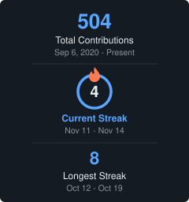

<div align="center">


<a href="https://git.io/typing-svg"></a>

[](https://www.linkedin.com/in/zaid-akroush/)
[](mailto:akroushzaid@proton.me)
[](https://github.com/zaid-akroush)
[](https://github.com/zaid-akroush)

</div>

---

### Who I Am



```python
zaid = {
    "role"     : "CS Student",
    "location" : "Debrecen, Hungary 🇭🇺  (from Jordan 🇯🇴)",
    "degree"   : "BSc CS, University of Debrecen",
    "building" : "agentwatch",

    "focus"    : [
        "AI & Machine Learning",
        "Systems Programming",
        "Developer Tools",
        "Security",
    ],
}
```

<br clear="right"/>

---

### ⚡ What I Build

<table>
<tr>
<td width="50%" valign="top">

**🤖 AI & ML**
Reinforcement learning agents, anomaly detection, and tooling for working with coding agents.

**⚙️ Systems**
Memory allocators and language interpreters written from scratch, with no libraries doing the hard part.

</td>
<td width="50%" valign="top">

**🛡️ Security & Privacy**
Log analysis for brute-force and port-scan detection, and tools that strip personal metadata.

**🌐 Web & Extensions**
Price trackers, browser extensions, and multiplayer browser games.

</td>
</tr>
</table>

---

### 🐍 Contribution Snake

<div align="center">
<picture>
  <source media="(prefers-color-scheme: dark)" srcset="https://raw.githubusercontent.com/zaid-akroush/zaid-akroush/output/github-snake-dark.svg"/>
  <source media="(prefers-color-scheme: light)" srcset="https://raw.githubusercontent.com/zaid-akroush/zaid-akroush/output/github-snake.svg"/>
  
</picture>
</div>

---

### 🚀 Featured Projects

<table>
<tr>
<td colspan="2" valign="top">

**[👁️ AgentWatch](https://github.com/LoomLabs-Venture-Studio/agentwatch)** · [agentwatch.info](https://agentwatch.info)

> Watches Claude Code, Cursor, Codex and other AI coding assistants while they work. Flags when one is going in circles, keeps failing, burns money, or does something risky with your keys or data. Runs locally on the logs your assistant already writes. `pipx install agentwatch-monitor`


</td>
</tr>
<tr>
<td width="50%" valign="top">

**[🪶 Quill](https://github.com/zaid-akroush/quill-lang)**

> Tree-walking interpreter for a dynamically typed scripting language with closures and first-class functions. Hand-written lexer, parser and interpreter, no dependencies.


</td>
<td width="50%" valign="top">

**[📖 Kilmeh](https://github.com/zaid-akroush/kilmeh)** · *(private)*

> An open benchmark for coding agents on Arabic — Arabic prompts, Arabic text inside code, and right-to-left (RTL) user interfaces. Deterministic graders, native-reviewed tasks, hermetic containers.


</td>
</tr>
</table>

---

### 🛠 Stack

<div align="center">

| Layer | Technologies |
|-------|-------------|
| **Languages** | Python · C · Java · JavaScript · TypeScript · C# · SQL · HTML/CSS |
| **AI / ML** | scikit-learn · NumPy · Isolation Forest · Unity ML-Agents (PPO) · Anthropic API · Jupyter |
| **Frontend** | React · Next.js · Vite · Tailwind CSS · Framer Motion · React Router |
| **Backend** | Node.js · Express · JWT · Helmet · node-cron · Web Push · Resend |
| **Databases** | Prisma · PostgreSQL · SQLite |
| **Games & Realtime** | Phaser 3 · Colyseus · WebSockets · Unity |
| **Systems** | Memory allocators · Interpreters · `LD_PRELOAD` · Make · Maven |
| **Desktop & Extensions** | Chrome Extensions (Manifest V3) · Tkinter / ttkbootstrap · Pillow |
| **Testing** | pytest · Jest · Supertest |
| **DevOps & Tools** | Git · GitHub Actions · Docker · Render · Linux · Claude Code |

</div>

---

<div align="center">

*Debrecen, Hungary · UTC+1*

</div>
